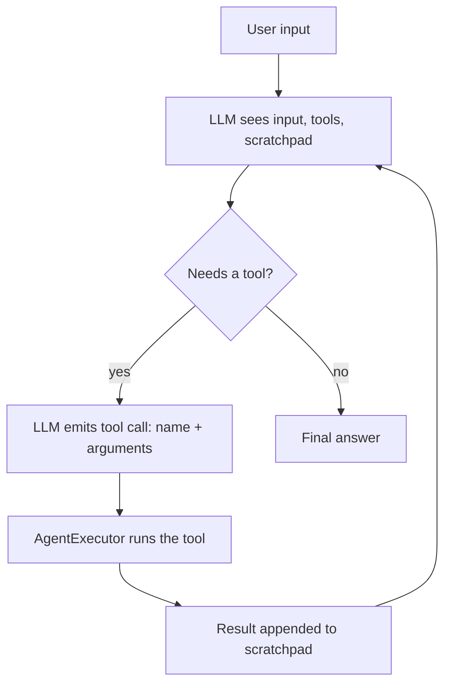
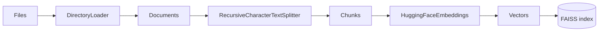
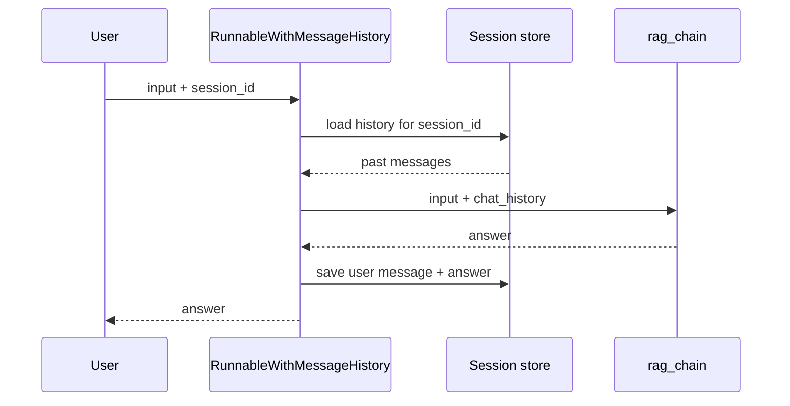
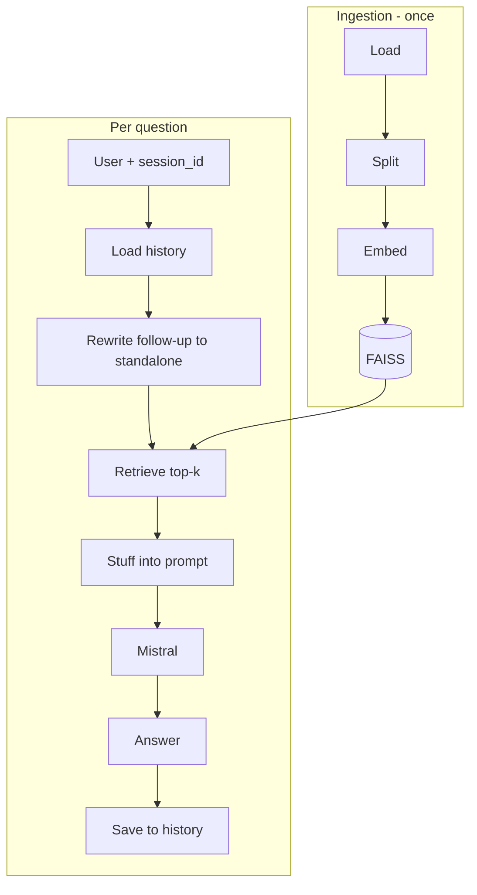

# 📘 LangChain Study Book

> [!abstract] What this covers
> Everything from the project's learning objectives: connecting LLMs, messages and prompts, agents and tools, DataFrame agents, retrieval (RAG), history-aware retrieval, and session memory.

## 🗺️ Roadmap

1. [[#1. What is LangChain?]]
2. [[#2. Connecting an LLM and getting answers]]
3. [[#3. Messages and why order matters]]
4. [[#4. Prompt templates]]
5. [[#5. Agents and tools]]
6. [[#6. Querying a DataFrame with an agent]]
7. [[#7. Loading, splitting and embedding documents]]
8. [[#8. Vector stores (FAISS)]]
9. [[#9. Retrieval chains]]
10. [[#10. History-aware retrieval]]
11. [[#11. Session awareness with RunnableWithMessageHistory]]
12. [[#12. The full pipeline]]
13. [[#13. Self-test: the learning objectives]]
14. [[#14. Cheat sheet and pitfalls]]

> [!note] Version note
> LangChain reorganized its packages in 1.0. Older chain helpers (`create_retrieval_chain`, `create_stuff_documents_chain`, `create_history_aware_retriever`, `AgentExecutor`) live in `langchain.chains` / `langchain.agents` in 0.x, and in the `langchain_classic` package in 1.x. If an import fails, swap `langchain` for `langchain_classic`. Always check the docs for the version you installed.

---

## 1. What is LangChain?

**LangChain is a framework for building applications around LLMs.** An LLM alone only turns text into text. LangChain gives you the glue to make it useful:

| Need | LangChain building block |
|---|---|
| Talk to many different model providers with one interface | Model integrations (`ChatMistralAI`, `HuggingFacePipeline`) |
| Structure the input | Messages and prompt templates |
| Let the model use external functions | Tools and agents |
| Give the model your own data | Document loaders, splitters, embeddings, vector stores, retrievers |
| Remember the conversation | Message history |
| Combine steps into a pipeline | Chains and the `|` operator (LCEL) |

> [!tip] One-sentence answer
> LangChain is a toolkit that standardizes how you connect LLMs to prompts, tools, data and memory so you can compose them into applications.

**Core idea: everything is a `Runnable`.** Models, prompts, retrievers and chains all share the same methods: `.invoke()`, `.stream()`, `.batch()`. That is why they can be chained:

```python
chain = prompt | llm | StrOutputParser()
chain.invoke({"topic": "vector stores"})
```

---

## 2. Connecting an LLM and getting answers

There are two routes to a model like Mistral:

| Route | Where it runs | Class | Needs |
|---|---|---|---|
| **API** | Mistral's servers | `ChatMistralAI` | API key |
| **Local** | Your machine (or Colab) | `HuggingFacePipeline` (+ `ChatHuggingFace`) | GPU/RAM, downloaded weights |

### 2.1 Mistral through the API (`ChatMistralAI`)

```bash
pip install langchain-mistralai
export MISTRAL_API_KEY="your-key"
```

```python
from langchain_mistralai import ChatMistralAI

llm = ChatMistralAI(model="mistral-large-latest", temperature=0)

response = llm.invoke("What is LangChain in one sentence?")
print(response.content)
```

- `temperature=0` makes answers near-deterministic. Higher values give more varied output.
- `invoke` returns an **`AIMessage`**. The text is in `.content`.

### 2.2 Mistral locally through Hugging Face

```bash
pip install langchain-huggingface transformers torch accelerate
```

```python
from langchain_huggingface import HuggingFacePipeline, ChatHuggingFace

base_llm = HuggingFacePipeline.from_model_id(
    model_id="mistralai/Mistral-7B-Instruct-v0.2",
    task="text-generation",
    pipeline_kwargs={"max_new_tokens": 256, "do_sample": False},
)

# Wrap it so it accepts chat messages and applies the model's chat template
llm = ChatHuggingFace(llm=base_llm)
print(llm.invoke("Explain embeddings briefly.").content)
```

- **Pipeline** = the Hugging Face `transformers` text-generation pipeline that does tokenization, generation and decoding.
- `HuggingFacePipeline` is a plain **text-in/text-out LLM**. `ChatHuggingFace` adds chat-message support.
- Some models need you to accept a licence on the Hugging Face website and run `huggingface-cli login`.

### 2.3 How do you "load the Mistral model"?

> [!tip] Short answer
> Either instantiate `ChatMistralAI(model=...)` with an API key (remote), or `HuggingFacePipeline.from_model_id(model_id=...)` to download and run the weights (local).

### 2.4 How do you get answers from an LLM?

```python
llm.invoke("question")                 # one answer, blocks until done
for chunk in llm.stream("question"):   # token-by-token streaming
    print(chunk.content, end="")
llm.batch(["q1", "q2", "q3"])          # several inputs at once
```

---

## 3. Messages and why order matters

Chat models take a **list of messages**, each with a role:

| Class | Role | Purpose |
|---|---|---|
| `SystemMessage` | system | Sets behavior, persona, rules. Usually first. |
| `HumanMessage` | user | What the user says or asks. |
| `AIMessage` | assistant | The model's earlier replies. |

```python
from langchain_core.messages import SystemMessage, HumanMessage

messages = [
    SystemMessage(content="You are a concise teaching assistant. Answer in 2 sentences."),
    HumanMessage(content="What is a vector store?"),
]
print(llm.invoke(messages).content)
```

### Why is message order important?

> [!important]
> A chat model reads the messages **as a conversation transcript, top to bottom**, and writes the next assistant turn. So order defines meaning.

- The **system message first** sets the rules before the model sees the user's request. Put it after, and many models weight it less or reject it.
- Roles must usually **alternate sensibly** (some models, including Mistral's chat templates, raise errors if the order is wrong, for example two user messages in a row or a system message in the middle).
- In multi-turn chats, the **latest human message is the question**. Earlier messages are context. Shuffling them changes what "it" or "that" refers to.
- Few-shot examples work because the model imitates the pattern *above* the final question.

```python
# Same messages, different order -> different (often worse) behavior
[HumanMessage("Translate: hello"), SystemMessage("Reply in French only")]   # ⚠️ rule arrives too late
[SystemMessage("Reply in French only"), HumanMessage("Translate: hello")]   # ✅
```

---

## 4. Prompt templates

A **prompt template** is a reusable prompt with `{placeholders}` filled at runtime. It separates the *fixed instructions* from the *variable input*.

### 4.1 `PromptTemplate` (plain text)

```python
from langchain_core.prompts import PromptTemplate

prompt = PromptTemplate.from_template(
    "Explain {concept} to a {audience} in {n} sentences."
)
print(prompt.format(concept="embeddings", audience="beginner", n=3))

chain = prompt | llm
chain.invoke({"concept": "embeddings", "audience": "beginner", "n": 3})
```

### 4.2 `ChatPromptTemplate` (list of role-tagged messages)

```python
from langchain_core.prompts import ChatPromptTemplate

chat_prompt = ChatPromptTemplate.from_messages([
    ("system", "You are a {role}. Answer in {language}."),
    ("human", "{question}"),
])

chain = chat_prompt | llm
chain.invoke({"role": "data science tutor", "language": "English", "question": "What is chunking?"})
```

### 4.3 How do prompt templates guide outputs?

- They **fix instructions, tone, format and constraints** so every call is consistent (for example "answer only from the context", "reply as JSON").
- They make prompts **testable and reusable**: change a variable, not the whole string.
- They **inject data** (retrieved documents, user question, history) in a controlled place.

### 4.4 Why use chat-style prompts?

- Modern models are trained on **role-separated conversations**, so system/human separation is followed more reliably than one big string.
- You get a clean slot for **history** (`MessagesPlaceholder`, see below) and for **few-shot examples** as alternating human/AI turns.
- The system message guards behavior while the human message carries untrusted user input, which also helps a bit against prompt injection.

### 4.5 `MessagesPlaceholder`

A slot that expands into **a list of messages** (history, agent scratchpad).

```python
from langchain_core.prompts import ChatPromptTemplate, MessagesPlaceholder
from langchain_core.messages import HumanMessage, AIMessage

prompt = ChatPromptTemplate.from_messages([
    ("system", "You are a helpful assistant."),
    MessagesPlaceholder("chat_history"),
    ("human", "{input}"),
])

prompt.invoke({
    "chat_history": [HumanMessage("My name is Sam"), AIMessage("Nice to meet you, Sam!")],
    "input": "What's my name?",
})
```

> [!tip] Remember
> `{variable}` inserts **text**. `MessagesPlaceholder` inserts **messages**.

---

## 5. Agents and tools

An **agent** uses the LLM as a *reasoning engine* that decides **which action to take next**, instead of just answering. The actions are **tools** (Python functions with a name, description and input schema).

### 5.1 Loading tools (`load_tools`)

```python
from langchain_community.agent_toolkits.load_tools import load_tools

tools = load_tools(["llm-math", "wikipedia"], llm=llm)
# llm-math needs an llm; wikipedia needs `pip install wikipedia`
```

You can also build your own:

```python
from langchain_core.tools import tool

@tool
def word_count(text: str) -> int:
    """Count the number of words in a piece of text."""
    return len(text.split())
```

> [!warning] Docstrings matter
> The **name and description** of each tool are what the LLM reads to choose it. Vague descriptions lead to wrong tool choices.

### 5.2 Creating the agent (`create_tool_calling_agent`)

```python
from langchain.agents import create_tool_calling_agent, AgentExecutor
from langchain_core.prompts import ChatPromptTemplate

prompt = ChatPromptTemplate.from_messages([
    ("system", "You are a helpful assistant. Use tools when needed."),
    ("human", "{input}"),
    ("placeholder", "{agent_scratchpad}"),   # required: where tool calls/results go
])

agent = create_tool_calling_agent(llm, tools, prompt)
```

- `create_tool_calling_agent` needs a model that supports **native tool calling** (Mistral does).
- `agent_scratchpad` is a message placeholder holding the running record of tool calls and their results.

### 5.3 Running it (`AgentExecutor`)

The agent only **decides**. The `AgentExecutor` is the **loop** that runs it.

```python
executor = AgentExecutor(
    agent=agent,
    tools=tools,
    verbose=True,                 # print the reasoning steps
    handle_parsing_errors=True,   # recover from malformed model output
    max_iterations=8,             # safety cap on loops
)

executor.invoke({"input": "What is 25% of 480, and who founded Wikipedia?"})
```



### 5.4 How does a multi-tool agent pick a tool?

> [!important]
> The tool **names, descriptions and argument schemas** are sent to the model along with the question. The model reasons about which description best fits the sub-task and outputs a structured **tool call** (name + JSON arguments). The executor runs it, feeds the result back, and the model decides whether to call another tool or answer.

So: it is **LLM reasoning over tool descriptions**, not hard-coded routing. Good descriptions, few overlapping tools and a clear system prompt improve selection.

### 5.5 Handling parsing errors

LLMs sometimes return output the agent can't parse (bad JSON, wrong format).

```python
AgentExecutor(agent=agent, tools=tools, handle_parsing_errors=True)
```

- `True` sends the error back to the model so it can **retry** instead of crashing.
- You can also pass a custom string or a function that returns the correction message.
- Pair it with `max_iterations` so retries cannot loop forever.

---

## 6. Querying a DataFrame with an agent

A pandas DataFrame agent lets you ask questions in natural language. The LLM **writes pandas code**, a Python tool **executes** it on your DataFrame, and the result is returned.

```bash
pip install langchain-experimental pandas tabulate
```

```python
import pandas as pd
from langchain_experimental.agents import create_pandas_dataframe_agent

df = pd.read_csv("sales.csv")

agent = create_pandas_dataframe_agent(
    llm,
    df,
    agent_type="tool-calling",
    verbose=True,
    allow_dangerous_code=True,    # required: the agent executes generated Python
)

agent.invoke("Which product had the highest total revenue? Show the top 3.")
```

### How can an agent query a DataFrame?

1. The agent's prompt includes a preview of the DataFrame (for example `df.head()`), so the model knows the column names and types.
2. Given your question, the LLM generates pandas code (`df.groupby(...).sum()...`).
3. A **Python REPL tool** runs the code against `df`.
4. The output returns to the LLM, which phrases the final answer (or fixes the code if it errored).

> [!danger] Security
> It runs LLM-generated code on your machine. Use only on trusted data, in a sandbox or container, and never expose it to untrusted users.

> [!tip] Handle errors
> Pass `agent_executor_kwargs={"handle_parsing_errors": True}` so the agent can retry on bad output.

---

## 7. Loading, splitting and embedding documents

This is the **ingestion** half of RAG (Retrieval-Augmented Generation).



### 7.1 Loading (`DirectoryLoader`)

```python
from langchain_community.document_loaders import DirectoryLoader, TextLoader

loader = DirectoryLoader(
    "./docs",
    glob="**/*.txt",            # which files to include (recursive)
    loader_cls=TextLoader,      # how to read each file
    loader_kwargs={"encoding": "utf-8"},
    show_progress=True,
)
documents = loader.load()       # list[Document]
```

A **`Document`** has two fields:
- `page_content`: the text
- `metadata`: a dict such as `{"source": "docs/a.txt"}`

> [!tip] How are documents loaded for retrieval?
> A loader reads files from disk (or the web, databases, PDFs...) and converts each one into `Document` objects with text plus metadata, ready to split and index. `DirectoryLoader` just applies a chosen loader to every file matching a glob pattern.

### 7.2 Splitting (`RecursiveCharacterTextSplitter`)

```python
from langchain_text_splitters import RecursiveCharacterTextSplitter

splitter = RecursiveCharacterTextSplitter(
    chunk_size=1000,       # max characters per chunk
    chunk_overlap=200,     # shared characters between neighbors
)
chunks = splitter.split_documents(documents)
```

It tries separators in order (`"\n\n"`, `"\n"`, `" "`, `""`), so it keeps **paragraphs, then sentences, then words** together as long as possible.

### Why split documents into chunks?

- **Context window limits**: whole documents may not fit in the prompt.
- **Precision**: a small chunk about one idea matches a question better than a 50-page file whose embedding is a blurry average.
- **Cost and speed**: you send only the relevant few chunks to the LLM.
- **Overlap** prevents an answer from being cut in half at a chunk boundary.

| Chunk too small | Chunk too large |
|---|---|
| Loses context, fragments ideas | Embeddings get vague, wastes tokens |

### 7.3 Embeddings (`HuggingFaceEmbeddings`)

```python
from langchain_huggingface import HuggingFaceEmbeddings

embeddings = HuggingFaceEmbeddings(
    model_name="sentence-transformers/all-MiniLM-L6-v2"
)

vec = embeddings.embed_query("What is a vector store?")
len(vec)    # 384 dimensions for this model
```

### How do embeddings help find relevant documents?

> [!important]
> An embedding model maps text to a **vector (list of numbers) where similar meaning means nearby vectors**. Embed every chunk once, embed the question at query time, then find the chunks whose vectors are **closest** (cosine similarity or L2 distance). This matches by **meaning**, not exact keywords: "car" can match "automobile".

> [!warning]
> Use the **same embedding model** for indexing and for querying. Vectors from different models are not comparable.

---

## 8. Vector stores (FAISS)

A **vector store** is a database built to **store embeddings and quickly return the nearest ones** to a query vector. **FAISS** (Facebook AI Similarity Search) is a fast local library for this.

```bash
pip install faiss-cpu
```

### 8.1 Build from documents

```python
from langchain_community.vectorstores import FAISS

vectorstore = FAISS.from_documents(chunks, embeddings)
```

This embeds every chunk and builds the index.

### 8.2 Search directly

```python
docs = vectorstore.similarity_search("How do embeddings work?", k=3)
docs_scores = vectorstore.similarity_search_with_score("How do embeddings work?", k=3)
```

### 8.3 Use as a retriever

```python
retriever = vectorstore.as_retriever(search_kwargs={"k": 4})
retriever.invoke("How do embeddings work?")   # -> list[Document]
```

A **retriever** is a simpler interface: *query string in, list of Documents out*. It plugs into chains. (Other search types: `search_type="mmr"` for more diverse results.)

### 8.4 Save and reload

```python
vectorstore.save_local("faiss_index")
vectorstore = FAISS.load_local(
    "faiss_index", embeddings, allow_dangerous_deserialization=True
)
```

### What is the role of a vector store?

Index embeddings **once**, then do fast **semantic nearest-neighbor search** over thousands or millions of chunks, returning the passages most relevant to each question.

---

## 9. Retrieval chains

### 9.1 `create_stuff_documents_chain`

"Stuff" = **stuff all retrieved documents into a single prompt** and call the LLM.

```python
from langchain.chains.combine_documents import create_stuff_documents_chain
from langchain_core.prompts import ChatPromptTemplate

qa_prompt = ChatPromptTemplate.from_messages([
    ("system",
     "Answer using ONLY the context below. "
     "If the answer is not in the context, say you don't know.\n\n"
     "Context:\n{context}"),
    ("human", "{input}"),
])

question_answer_chain = create_stuff_documents_chain(llm, qa_prompt)
```

The prompt **must contain `{context}`**. The chain formats the list of documents into that slot.

### 9.2 `create_retrieval_chain`

Wires **retriever → stuff chain** together.

```python
from langchain.chains import create_retrieval_chain

rag_chain = create_retrieval_chain(retriever, question_answer_chain)

result = rag_chain.invoke({"input": "What is chunk overlap used for?"})
result["answer"]     # the LLM's reply
result["context"]    # the retrieved Documents (great for citing sources)
```

```mermaid
flowchart LR
    Q[input] --> R[Retriever]
    R --> D[Top-k documents]
    D --> S[Stuff chain: fill {context}]
    Q --> S
    S --> L[LLM]
    L --> A[answer]
```

### How do retrieval chains combine documents and LLMs?

1. Take the user's `input`.
2. The **retriever** fetches the top-k relevant chunks.
3. The **stuff chain** inserts those chunks into the prompt as `{context}`.
4. The **LLM** answers grounded in that context.
5. The output dict has `input`, `context` and `answer`.

This **grounds** the model in your data, which reduces hallucination and lets it answer about content it was never trained on.

---

## 10. History-aware retrieval

### The problem

Follow-up questions are often not self-contained:

> User: "What is FAISS?"  
> User: "**How do I install it?**" ← "it" means nothing to the retriever

If you embed "How do I install it?" alone, the search returns junk.

### The fix: `create_history_aware_retriever`

It uses the LLM to **rewrite the follow-up into a standalone question** using the chat history, then retrieves with that rewritten query.

```python
from langchain.chains import create_history_aware_retriever
from langchain_core.prompts import ChatPromptTemplate, MessagesPlaceholder

contextualize_q_prompt = ChatPromptTemplate.from_messages([
    ("system",
     "Given the chat history and the latest user question, rewrite the question "
     "so it can be understood without the chat history. "
     "Do NOT answer it. Return it unchanged if it is already standalone."),
    MessagesPlaceholder("chat_history"),
    ("human", "{input}"),
])

history_aware_retriever = create_history_aware_retriever(
    llm, retriever, contextualize_q_prompt
)
```

Behavior:
- **No history** → passes `input` straight to the retriever.
- **With history** → LLM rewrites ("How do I install FAISS?") → retriever.

### Full conversational RAG chain

The final QA prompt now also carries the history:

```python
qa_prompt = ChatPromptTemplate.from_messages([
    ("system",
     "Answer using ONLY the context below. If unsure, say you don't know.\n\n"
     "Context:\n{context}"),
    MessagesPlaceholder("chat_history"),
    ("human", "{input}"),
])

question_answer_chain = create_stuff_documents_chain(llm, qa_prompt)
rag_chain = create_retrieval_chain(history_aware_retriever, question_answer_chain)
```

### How does history improve retrieval results?

> [!important]
> Retrieval only sees the **query text**. History lets the LLM **resolve pronouns and implicit references** ("it", "that one", "the second option") into a complete question, so the embedding matches the right chunks.

---

## 11. Session awareness with `RunnableWithMessageHistory`

`rag_chain` itself is **stateless**: it only knows what you pass in. `RunnableWithMessageHistory` wraps a chain so it **automatically loads and saves history per session**.

```python
from langchain_core.chat_history import BaseChatMessageHistory
from langchain_community.chat_message_histories import ChatMessageHistory
from langchain_core.runnables.history import RunnableWithMessageHistory

store: dict[str, BaseChatMessageHistory] = {}

def get_session_history(session_id: str) -> BaseChatMessageHistory:
    if session_id not in store:
        store[session_id] = ChatMessageHistory()
    return store[session_id]

conversational_rag_chain = RunnableWithMessageHistory(
    rag_chain,
    get_session_history,
    input_messages_key="input",         # which input field is the new user message
    history_messages_key="chat_history",# which prompt variable receives the history
    output_messages_key="answer",       # which output field is the AI reply to save
)

cfg = {"configurable": {"session_id": "alice-1"}}

conversational_rag_chain.invoke({"input": "What is FAISS?"}, config=cfg)
conversational_rag_chain.invoke({"input": "How do I install it?"}, config=cfg)   # "it" resolved!
```

What happens on each call:



### How does session awareness maintain context?

> [!important]
> Each conversation gets a **`session_id`**. A history store keeps that session's messages. On every call the wrapper **injects the stored history** into the chain and **appends the new exchange** afterwards. Different session IDs keep different users' conversations separate, and the same ID continues the same conversation.

Notes:
- `ChatMessageHistory` is **in-memory** (lost on restart). For persistence use Redis, SQL, files, and so on.
- Long histories grow token usage. Trim or summarize them in production.
- The three `*_messages_key` values **must match** the names in your prompts and outputs, or history will silently not flow.

---

## 12. The full pipeline

```python
# --- Ingestion (run once) ---
from langchain_community.document_loaders import DirectoryLoader, TextLoader
from langchain_text_splitters import RecursiveCharacterTextSplitter
from langchain_huggingface import HuggingFaceEmbeddings
from langchain_community.vectorstores import FAISS

docs = DirectoryLoader("./docs", glob="**/*.txt", loader_cls=TextLoader).load()
chunks = RecursiveCharacterTextSplitter(chunk_size=1000, chunk_overlap=200).split_documents(docs)
embeddings = HuggingFaceEmbeddings(model_name="sentence-transformers/all-MiniLM-L6-v2")
retriever = FAISS.from_documents(chunks, embeddings).as_retriever(search_kwargs={"k": 4})

# --- Model ---
from langchain_mistralai import ChatMistralAI
llm = ChatMistralAI(model="mistral-large-latest", temperature=0)

# --- Chains ---
from langchain.chains import create_history_aware_retriever, create_retrieval_chain
from langchain.chains.combine_documents import create_stuff_documents_chain
from langchain_core.prompts import ChatPromptTemplate, MessagesPlaceholder

contextualize = ChatPromptTemplate.from_messages([
    ("system", "Rewrite the latest question to be standalone using the chat history. Do not answer it."),
    MessagesPlaceholder("chat_history"),
    ("human", "{input}"),
])
qa = ChatPromptTemplate.from_messages([
    ("system", "Answer ONLY from this context. If unknown, say so.\n\n{context}"),
    MessagesPlaceholder("chat_history"),
    ("human", "{input}"),
])

hist_retriever = create_history_aware_retriever(llm, retriever, contextualize)
rag_chain = create_retrieval_chain(hist_retriever, create_stuff_documents_chain(llm, qa))

# --- Sessions ---
from langchain_community.chat_message_histories import ChatMessageHistory
from langchain_core.runnables.history import RunnableWithMessageHistory

store = {}
def get_history(sid):
    return store.setdefault(sid, ChatMessageHistory())

chat = RunnableWithMessageHistory(
    rag_chain, get_history,
    input_messages_key="input",
    history_messages_key="chat_history",
    output_messages_key="answer",
)

cfg = {"configurable": {"session_id": "demo"}}
print(chat.invoke({"input": "What is chunk overlap?"}, config=cfg)["answer"])
print(chat.invoke({"input": "Why is it useful?"}, config=cfg)["answer"])
```

---

## 13. Self-test: the learning objectives

> [!question]- What is LangChain?
> A framework that standardizes connecting LLMs to prompts, tools, external data and memory, and lets you compose them into chains and agents through a common `Runnable` interface.

> [!question]- How do you connect an LLM to LangChain?
> Use a provider integration class: `ChatMistralAI(model=..., api_key=...)` for the hosted API, or `HuggingFacePipeline.from_model_id(...)` (optionally wrapped by `ChatHuggingFace`) for a local model.

> [!question]- How do you load the Mistral model?
> Remotely: set `MISTRAL_API_KEY` and create `ChatMistralAI`. Locally: `HuggingFacePipeline.from_model_id("mistralai/Mistral-7B-Instruct-v0.2", task="text-generation")`, which downloads the weights and builds a `transformers` pipeline.

> [!question]- How do you get answers from an LLM?
> Call `llm.invoke(input)`. Input can be a string or a list of messages. The result is an `AIMessage` (read `.content`). Use `.stream()` for tokens as they arrive and `.batch()` for many inputs.

> [!question]- Why is message order important in chat?
> The model treats the list as a transcript and continues it. The system message must come first to set rules, roles must alternate properly (some models error otherwise), and the last human message is the question while earlier ones are context.

> [!question]- How do prompt templates guide outputs?
> They hold fixed instructions, format rules and slots for variables, so each call gets consistent, controllable instructions with only the dynamic parts changing.

> [!question]- Why use chat-style prompts?
> Models are trained on role-separated conversations, so system, human and AI roles are followed more reliably. They also give clean places for history (`MessagesPlaceholder`), few-shot examples and the agent scratchpad.

> [!question]- How does a multi-tool agent pick a tool?
> The LLM receives every tool's name, description and argument schema plus the question, reasons about which fits, and emits a structured tool call. `AgentExecutor` runs it, returns the result, and the LLM repeats until it can give a final answer.

> [!question]- How can an agent query a DataFrame?
> `create_pandas_dataframe_agent` shows the LLM the DataFrame's structure; the LLM writes pandas code, a Python tool executes it on `df`, and the LLM turns the result into an answer. It needs `allow_dangerous_code=True` because it runs generated code.

> [!question]- How are documents loaded for retrieval?
> Loaders such as `DirectoryLoader` (with a `loader_cls` and glob) read files and produce `Document` objects containing `page_content` and `metadata`.

> [!question]- Why split documents into chunks?
> To fit context windows, make embeddings more precise, reduce cost by sending only relevant parts, and (with overlap) avoid losing information at chunk boundaries.

> [!question]- How do embeddings help find relevant documents?
> They turn text into vectors where similar meaning is close together, so the closest chunk vectors to a question vector are the semantically relevant passages, even without shared keywords.

> [!question]- What is the role of a vector store?
> It stores the chunk embeddings and performs fast nearest-neighbor search, returning the most relevant chunks for a query (FAISS locally, via `from_documents` and `as_retriever`).

> [!question]- How does history improve retrieval results?
> A history-aware retriever has the LLM rewrite follow-ups ("how do I install it?") into standalone questions using the chat history, so the search query actually contains the subject.

> [!question]- How do retrieval chains combine documents and LLMs?
> `create_retrieval_chain` calls the retriever, `create_stuff_documents_chain` inserts the retrieved docs into the prompt's `{context}`, and the LLM answers grounded in them. Output: `input`, `context`, `answer`.

> [!question]- How does session awareness maintain context?
> `RunnableWithMessageHistory` looks up a per-`session_id` history store, injects it into the chain on each call, and saves the new human and AI messages afterwards.

---

## 14. Cheat sheet and pitfalls

### Quick reference

| Task | Code |
|---|---|
| Remote Mistral | `ChatMistralAI(model="mistral-large-latest")` |
| Local model | `HuggingFacePipeline.from_model_id(...)` |
| Ask | `llm.invoke(...)` → `.content` |
| System / user msg | `SystemMessage`, `HumanMessage` |
| Text template | `PromptTemplate.from_template(...)` |
| Chat template | `ChatPromptTemplate.from_messages([...])` |
| History slot | `MessagesPlaceholder("chat_history")` |
| Built-in tools | `load_tools([...], llm=llm)` |
| Agent | `create_tool_calling_agent(llm, tools, prompt)` |
| Run agent | `AgentExecutor(agent=, tools=, handle_parsing_errors=True)` |
| DataFrame agent | `create_pandas_dataframe_agent(llm, df, allow_dangerous_code=True)` |
| Load files | `DirectoryLoader(path, glob=, loader_cls=)` |
| Split | `RecursiveCharacterTextSplitter(chunk_size=, chunk_overlap=)` |
| Embed | `HuggingFaceEmbeddings(model_name=)` |
| Index | `FAISS.from_documents(chunks, embeddings)` |
| Retriever | `vs.as_retriever(search_kwargs={"k": 4})` |
| Stuff chain | `create_stuff_documents_chain(llm, prompt)` (prompt has `{context}`) |
| Standalone question | `create_history_aware_retriever(llm, retriever, prompt)` |
| RAG chain | `create_retrieval_chain(retriever, qa_chain)` |
| Sessions | `RunnableWithMessageHistory(chain, get_history, input_messages_key=, history_messages_key=, output_messages_key=)` |

### Common pitfalls

> [!bug] Debug checklist
> - ❌ **Missing `{context}`** in the stuff-chain prompt → error or ignored documents.
> - ❌ **Missing `agent_scratchpad`** in the agent prompt → agent can't use tool results.
> - ❌ **Different embedding models** for indexing vs querying → garbage retrieval.
> - ❌ **History keys don't match** (`chat_history` vs `history`) → memory silently not used.
> - ❌ **Wrong output key** (`answer`) in `RunnableWithMessageHistory` → AI replies not saved.
> - ❌ **System message not first** → ignored or rejected.
> - ❌ **Chunks too big/small** → vague or fragmented retrieval. Start with 500 to 1000 chars and 10 to 20% overlap, then tune.
> - ❌ **Vague tool descriptions** → agent picks the wrong tool.
> - ❌ **No `max_iterations`** → possible runaway agent loops.
> - ❌ **Running the DataFrame agent on untrusted input** → arbitrary code execution risk.
> - ❌ **Imports not found** → check version; try `langchain_classic` (1.x) or `langchain` (0.x).

### Mental model in one picture



---

## ✅ Study plan

- [ ] Run a basic `invoke` with `ChatMistralAI`
- [ ] Build one `ChatPromptTemplate` with a `MessagesPlaceholder`
- [ ] Create a 2-tool agent and read the verbose trace
- [ ] Ask 3 questions to a CSV via the pandas agent
- [ ] Index a folder of `.txt` files into FAISS
- [ ] Build a `create_retrieval_chain` and print `result["context"]`
- [ ] Add a history-aware retriever and test a follow-up with "it"
- [ ] Wrap it in `RunnableWithMessageHistory` with two different `session_id`s
- [ ] Explain every objective in section 13 out loud, without notes

#langchain #rag #agents #study